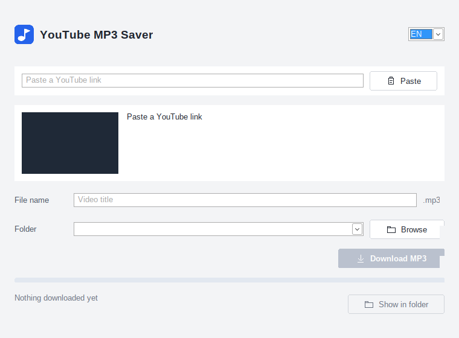

# MPTube

Paste a YouTube link, pick a folder… and get an MP3. That's it (I promise).

<p align="center">
  
</p>

Windows 10 or later, 64-bit. Grab it from the [Releases](https://github.com/wrongpixels/MPTube/releases) page and run it. No install.

## Features and such

- Previews title, duration and thumbnail before downloading
- Best available audio, saved as MP3 (lossy, and it does not pull down a whole video just to get the sound)
- Auto-numbered file names if one already exists (`Title (1).mp3`, `Title (2).mp3`, …)
- Remembers recent folders and language (English / Spanish)
- **Paste** only reads the clipboard when you click it. Playlist and tracking junk is dropped. A playlist with no video is left alone
- After the file is written, **Show in folder** opens Explorer with that MP3 selected

A folder that isn't there (a drive you unplugged, for example) stays in the list with the path you saved. MPTube does not clear it, replace it, or create it.

## Requirements

No Python, Java, or administrator install. The .exe does not bundle the helper programs. The first time a preview or download needs them, MPTube downloads these builds over HTTPS, checks their SHA-256 checksums, and keeps them in `%LOCALAPPDATA%\YouTubeMP3Saver\tools\`:

- yt-dlp 2026.10.26
- FFmpeg 9.0.2 essentials (Gyan / GyanD)
- Deno 2.9.8, the JavaScript runtime yt-dlp uses for YouTube

If those exact versions are already cached, they are reused. A file that fails the checksum is thrown away. YouTube changes things, so a video can still fail.

Language, the last folder, and recent folders are stored in `%APPDATA%\YouTubeMP3Saver\settings.json`.

## Build from source

Go 1.26. From the repository root, on Linux or Windows:

```
GOOS=windows GOARCH=amd64 CGO_ENABLED=0 go build -ldflags="-H windowsgui -s -w" -o dist/MPTube.exe ./cmd/youtubemp3
```

`scripts/build.sh` runs that command. The Windows manifest and icon are embedded from `cmd/youtubemp3/rsrc_windows_amd64.syso` when that file is present.

## Personal use

Use it only with videos you own or are authorized to download. Do not use it to copy other people's work or to bypass YouTube restrictions, DRM, or private/account-only content. Respect YouTube's terms and copyright. The app does not log in, store cookies, or send anything on your behalf.

The software is provided as is, without warranty of any kind.

## Licenses

The app license, third-party notices, and the helper-tool checksums are in [LICENSES/](LICENSES/).
